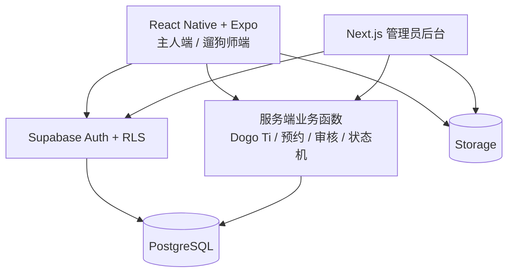

# DOGO MVP 技术实施方案

> **版本**：v1.0  
> **日期**：2026-11-01  
> **适用范围**：DOGO MVP（用户端、遛狗师端、管理员后台）  
> **需求依据**：`DOGO_MVP_PRD_v1.0(2).docx` 及团队已确定的 AI 辅助开发方式  
> **命名约定**：原 **PawStyle** 统一更名为 **Dogo Ti**；本方案不改变原问卷题目、评分公式和业务安全规则。

## 1. 目标与范围

本方案用于指导 AI 编程工具与小组成员实现一个**真实可交互、数据可持久化、可完整演示服务流程**的 DOGO MVP。产品方向与市场验证已由团队确认，不在本方案中重复论证。

### MVP 必须覆盖的功能

| 模块 | 功能范围 |
|---|---|
| 账户与档案 | 注册/登录、角色权限、狗狗档案、紧急联系人 |
| Dogo Ti | 完整问卷、暂存与提交、计算与结果、四风格/五维展示、分享卡 |
| Solo Walk | 可预约时段、预约提交、确认指派、订单状态 |
| Pack Walk | Pack 浏览、加入申请、安全人工审核、首次见面记录、活动报名 |
| 遛狗执行 | 遛狗师任务、接送交接、开始/结束、异常事件、完成报告 |
| 运营管理 | 管理员管理用户/遛狗师/时段/Pack/订单/审核，站内通知和审计 |

**本版不实现**：在线支付/退款、实时 GPS 追踪、用户聊天社区、AI 自动匹配、自动派单、复杂订阅。不能为了演示方便跳过真实的数据权限和安全审核。

## 2. 推荐技术栈与选型

| 层级 | 技术 | 职责与原因 |
|---|---|---|
| 移动客户端 | **React Native + Expo + TypeScript** | 同一套代码覆盖 iOS/Android；主人与遛狗师按角色呈现不同界面 |
| 移动路由 | **Expo Router** | 管理登录、首页、问卷、预约、任务等页面路由 |
| 管理员 Web 后台 | **Next.js + TypeScript** | 浏览器中处理审核、指派、时段、订单和异常事件 |
| 云端后端 | **Supabase** | 使用现成认证、PostgreSQL、对象存储与服务端函数能力 |
| 数据库 | **Supabase PostgreSQL** | 保存关系数据、订单状态、评分记录，支持约束与事务 |
| 身份认证 | **Supabase Auth** | MVP 优先邮箱注册；角色/资源级授权另行实现 |
| 服务端业务逻辑 | **Supabase Edge Functions + PostgreSQL 事务/函数** | 处理 Dogo Ti 正式计分、预约库存、审批、状态迁移、通知触发 |
| 文件存储 | **Supabase Storage** | 狗狗头像、服务报告图片和分享卡输出，配置访问策略 |
| 设计/协作 | **Figma + GitHub** | 品牌设计规范、代码协作、PR 审查、Issue 管理 |
| 自动测试 | **Vitest（纯函数）+ 集成测试 + 端到端手动验收** | 重点验证计分、权限、状态机、库存和主流程 |

**统一原则**：尽量使用 TypeScript；不为了 Dogo Ti 引入 Python/机器学习；MVP 不额外搭建独立 Spring Boot / Django 服务。若后续复杂度显著增加，再评估独立后端。

## 3. 整体架构



- **读取自己的普通数据**：客户端通过 Supabase SDK，在行级权限（RLS）保护下获取。
- **涉及业务规则的写操作**：统一调用可信服务端入口，不允许客户端直接修改计分结果、审核决定、库存或关键订单状态。
- **管理员操作**：服务端再次校验管理员角色及操作权限，并写入审计记录；隐藏按钮不等于权限控制。
- **原子性**：名额占用与订单创建、Pack 容量检查与报名、状态变更与日志，应使用数据库事务/约束保证一致性。

## 4. 项目目录建议

```text
DOGO/
├── apps/
│   ├── mobile/                 # Expo：主人端 + 遛狗师端
│   └── admin/                  # Next.js：管理员 Web 后台
├── packages/
│   ├── ui/                     # 共享设计 token/规范；Web 与 Native 组件分别实现
│   ├── domain/                 # 通用 TS 类型、状态枚举、校验规则
│   └── dogo-ti/                # 问卷定义、纯评分算法、单元测试
├── supabase/
│   ├── migrations/             # 版本化 SQL 迁移、RLS、约束
│   ├── functions/              # 关键服务端业务入口
│   └── seed.sql                # 演示数据（不含真实敏感数据）
├── assets/
│   └── brand/                  # 团队正式 Logo 与品牌源文件（待放入）
├── docs/
│   └── DOGO_TECHNICAL_PLAN.md  # 本文件
└── README.md
```

建议使用单一 GitHub 仓库（monorepo）；团队可以按照模块分支开发，但需共享相同的数据类型、状态名称、数据库迁移和设计规范。

## 5. 核心业务实现

### 5.1 用户与狗狗档案

- MVP 使用邮箱注册/登录，支持主人（Owner）、遛狗师（Walker）、管理员（Admin）。
- 采用 Supabase Auth 身份认证；业务信息保存至 `profiles` / `user_roles` 等业务表。
- 狗档案包括昵称、年龄、体重、可选照片、健康/装备备注、疫苗状态及紧急联系人；一位主人可以管理多只狗。
- 敏感健康信息和联系电话只向有明确业务需要的角色开放。

### 5.2 Dogo Ti（原 PawStyle）

- **对用户统一呈现**：“Dogo Ti 性格测试”“Dogo Ti 结果”“Dogo Ti 分享卡”。不得再在界面出现 PawStyle。
- **保持 PRD 原算法**：B1–B6（背景）、D1–D45（核心）、S1–S6（情境）；D 题选择 1–5 或 `X`；`X` 表示未观察/不适用，对应缺失值，绝不等于 3。
- 14 道反向计分题使用 `6-x`；15 个分面每个由 3 题组成，任一题缺失则该分面不评分；五维分数及 E/P 风格计算完全按 PRD 第 6 节执行。
- 风格代码继续保留 **EP / CP / EL / CL**；中点与缺失分别显示“混合倾向”“待补充”，不可强制分类。接近分界值时提供轻微倾向提示。
- 保存**问卷版本、原始答案、独立评分结果、评分版本、测评时间**，每次重测产生新记录，不能覆盖历史。
- 风险事件与问卷分数分开记录；Dogo Ti **不能自动代替 Pack 的人工安全判断**。
- 分享卡只展示经用户选择的昵称、风格、简要结果和可选照片；不得泄漏电话、地址、健康/攻击事件。
- 评分算法开发为可测试的纯 TypeScript 模块，在服务端提交时重新计算；客户端可以预览，但不能自报最终分数。

### 5.3 Solo Walk

- 主人选择狗、时段、时长、交接点和备注后提交预约。
- 状态以 PRD 为准：`requested → confirmed → in_progress → completed`；支持按规则 `cancelled` 及异常复核。
- 管理员人工确认、分配遛狗师；遛狗师负责接狗、执行、归还及报告。
- 防止同一时段与同一遛狗师被重复占用；冲突由数据库事务/唯一约束处理，不仅靠前端按钮禁用。

### 5.4 Pack Walk

- 将 **Pack 资格审核** 与 **单次 Pack 活动报名** 分开建模，避免“审批通过 = 自动参加任意活动”的误解。
- 申请主要状态：`submitted → safety_review → [intro_scheduled] → approved / rejected / needs_more_info`（按审核需要安排首次见面）。
- 管理员核对 S 情境事件、行为历史、健康和体型等必要条件，并记录首次见面结果；审批必须记录责任人、时间和理由。
- 只有获得对应资格的狗才能报名该 Pack 的活动；单次活动仍需校验名额、时间与状态。

### 5.5 任务、报告和通知

- 遛狗师仅能访问分配给自己的任务及必要信息；记录接狗、开始、结束、归还时间。
- 任务完成后填写报告；异常事件可以单独登记并交由管理员处理。
- 站内通知覆盖预约确认/取消、Pack 审核、首次见面安排、任务完成等关键事件。
- 管理员后台提供待审核队列、订单/人员/时段管理及异常事件记录。

## 6. 数据设计（核心逻辑实体）

与原 PRD 的逻辑模型保持一致，建议按模块分组建表：

| 领域 | 建议实体 |
|---|---|
| 账号与狗 | `profiles`, `user_roles`, `dogs`, `emergency_contacts`, `walkers` |
| Dogo Ti | `questionnaire_definitions`, `assessment_sessions`, `assessment_answers`, `assessment_scores`, `behavior_incidents`, `share_cards` |
| Solo | `service_slots`, `solo_bookings` |
| Pack | `packs`, `pack_events`, `pack_applications`, `intro_meetings`, `pack_memberships`, `pack_event_bookings` |
| 执行与运营 | `walk_tasks`, `handoff_records`, `walk_reports`, `notifications`, `audit_logs` |

说明：这里使用 `assessment_*` 作为**数据库领域实体名**，前端产品名称始终为 **Dogo Ti**。如希望连数据库都统一品牌命名，可在首次建库前改为 `dogo_ti_*`；一旦开始开发，应冻结命名并通过数据库迁移管理，不要混用。

关键约束：外键、唯一索引、状态枚举、时间戳、软删除或留档策略；`dog_id + assessment_session` 关联；订单/Pack 活动名额的并发保护；角色和资源范围的 RLS；必要操作必须留痕。

## 7. Logo 驱动的 UI / 设计系统

> 团队已拥有正式 Logo，但该 Logo 文件**未包含在本技术方案输入中**，因此不能凭空指定品牌色值、字体或图形元素。实施前请将正式 Logo 文件放入 `assets/brand/`。

### UI 设计流程

1. **先解析 Logo**：让 AI 分析实际色彩、线条/几何语言、圆角与比例、视觉气质，并给出明确设计依据。
2. **建立设计 token**：输出主色/辅色/背景色/文本色/状态色、字号、间距、圆角、阴影、图标、组件状态；集中管理在 `packages/ui/`。
3. **先审查关键页面**：优先完成首页、Dogo Ti 问卷、Dogo Ti 结果、Solo 预约、Pack 详情/审核状态的 UI；团队认可后再扩展。
4. **再代码化**：让 AI 根据已经批准的 token 实现可复用按钮、卡片、表单、进度条、导航和状态组件。
5. **全局检查**：保证主人端、遛狗师端和后台视觉一致；移动端内容清楚、字体可读、交互状态完整。

### 可直接交给 AI 编程助手的设计指令

```text
You are the UI implementation lead for DOGO, a dog-walking app.
Use our actual logo located in assets/brand/ as the primary visual reference.
First analyze its colors, geometry, line style, proportions, and brand tone.
Do not invent a logo or assume brand colors without inspecting the asset.

Create a reusable design system with color, typography, spacing, radius,
icons, buttons, cards, forms, and accessibility states. Save the design
tokens and explain how each choice relates to the logo.

Apply the approved system consistently across the React Native/Expo app
and the Next.js admin console. Prioritize modern, friendly, trustworthy,
clean UI that feels like a real DOGO product, not a generic pet template.

The personality feature is named "Dogo Ti" everywhere in user-facing UI.
Keep Solo Walk and Pack Walk easy to discover. Do not change business logic,
scoring rules, authorization or database behavior merely for visual design.

First propose the design tokens and five representative screens. After
approval, implement reusable components and the remaining screens.
```

**注意**：Logo 是设计依据，不是要求每一屏都重复堆放 Logo。不要未经团队确认就任意添加卡通插画、品牌主色或游戏化装饰。

## 8. AI 编程协作规则

- **一条任务只做一个业务模块**：先读本技术方案与 PRD，提出文件更改清单，再实现、测试、提交。
- **禁止 AI 擅自改范围**：不得新增支付、聊天、GPS、AI 匹配；不得修改 Dogo Ti 算法、Pack 人工审核或角色权限。
- **契约先行**：先统一 TypeScript 类型、状态枚举、数据库迁移，再做相应界面；不要先用假数据写完页面后才补后端。
- **提交标准**：每个 PR 说明功能、修改文件、验证结果、数据库变更和截图；关键逻辑必须有测试。
- **环境隔离**：开发/演示与正式环境分开；密钥进入环境变量，永远不要提交服务角色密钥或真实用户数据到 Git。
- **工作方式**：同一时间避免多个 AI 代理直接改相同迁移文件和核心模型；冲突由指定负责人合并。

### 通用开发任务提示词

```text
Read docs/DOGO_TECHNICAL_PLAN.md and the DOGO MVP PRD before coding.
Implement ONLY the following module: <MODULE>.
Keep the agreed stack: Expo/React Native + TypeScript, Next.js admin,
Supabase Auth/PostgreSQL/Storage/Edge Functions.
Use "Dogo Ti" in all user-facing copy; preserve original assessment rules.
Follow the approved logo-derived design tokens, RLS, role checks,
server-side validation, and auditable state transitions.
Before coding, list the files, schema changes, and acceptance tests.
After coding, run relevant tests and summarize what is complete,
what remains, and any assumptions. Never claim untested work passed.
```

## 9. 开发顺序与验收

| 阶段 | 主要交付 | 完成标准 |
|---|---|---|
| Sprint 1 · 基础 | 初始化仓库、认证、权限、狗档案、数据库迁移、初版 UI token | 可登录并持久保存/查看自己的狗档案；越权访问被拒 |
| Sprint 2 · Dogo Ti | 完整问卷、草稿、评分服务、结果展示、基础分享卡 | PRD 第 6 节标准算例、反向题、X、中点、历史版本测试通过 |
| Sprint 3 · 预约与审核 | Solo 预约、Pack 浏览/申请、首见记录、人工审核 | 两条流程可完整提交；重复占位/未审核入组被阻止 |
| Sprint 4 · 执行与后台 | 遛狗师任务、交接、报告、站内通知、管理员工作台 | 管理员指派后可执行和完结，主人能查看报告 |
| Sprint 5 · 集成测试 | 端到端回归、权限与异常、UI 一致性、演示数据 | Owner/Walker/Admin 各自流程可演示，关键异常有可理解反馈 |

**最终演示至少覆盖两个闭环**：

1. Owner 注册 → 创建狗 → Dogo Ti → Solo 预约 → Admin 指派 → Walker 执行 → 完成报告 → Owner 查看。
2. Owner 申请 Pack → Admin 审核/首次见面 → 资格批准 → 参加具体 Pack 活动 → Walker 执行 → 报告。

必须额外测试：一个用户无法读别人的档案/问卷/订单；Walker 不能看无关任务；未批准不能入组；重复提交不会产生双重预约；分享卡不暴露敏感信息。

## 10. 尚需团队在开发前固定的参数

以下为**原 PRD 中尚未确认的运营项**，不是让 AI 自行决定：

- Solo 允许的时长、一次几只狗、服务区域和时段发布方式。
- Pack 容量、固定群组与单次活动的关系、首见是否对所有申请必需。
- 取消/改期规则、遛狗师资格审核人、异常事件处理负责人。
- 统一的正式 Logo 文件、品牌色板及页面视觉规范。

可先将这些项设为可配置演示值，最终由小组明确后锁定。

## 11. 参考资料

- 内部：《DOGO MVP PRD v1.0》（2026-11-01），是功能、问卷公式、数据库逻辑与状态规则的首要依据。
- [Expo 官方入门文档](https://docs.expo.dev/tutorial/introduction/)
- [Next.js App Router 官方文档](https://nextjs.org/docs/app)
- [Supabase Database 官方文档](https://supabase.com/docs/guides/database/overview)
- [Supabase Auth 官方文档](https://supabase.com/docs/guides/auth)
- [Supabase Edge Functions 与 Postgres 官方文档](https://supabase.com/docs/guides/functions/connect-to-postgres)

---

**实施原则**：保留已确定的 DOGO 产品方向；技术选型以快速稳定交付为目标；用正式 Logo 建立一致设计系统；以 Dogo Ti、Solo Walk 和 Pack Walk 的真实业务闭环作为核心交付。
